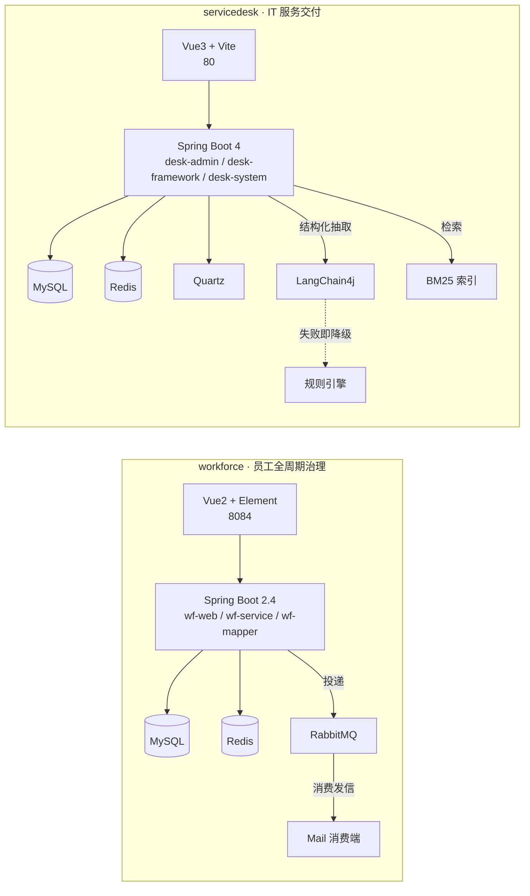

# 员工全周期治理 · IT 服务交付

两个独立部署的 Java 后端系统，放在同一个仓库里，共用一套本地基础设施。

一个用规则、事务和索引处理**确定性流程**，一个在确定性流程之上叠**大模型能力**，
但两者的共同点是：先保证幂等、状态与权限的正确性，再谈其他。

| | 员工全周期治理系统 | IT 服务交付系统 |
|---|---|---|
| 目录 | [`workforce/`](workforce/) | [`servicedesk/`](servicedesk/) |
| 面向 | HR | 企业内部 IT 运维 |
| 解决什么 | 谁 7 天内要转正、谁的合同要到期，不靠翻 Excel 盯 | 员工报故障到 IT 处理关闭，描述口语化、无法筛选与派单 |
| 关键机制 | 唯一索引幂等、组合索引、规则收口、事务边界、30 天冷静期、邮件重试、统计与人事记录、本地头像存储 | 表驱动状态机、按动作拆接口、功能与数据双层权限、AI 分诊与降级、AI 设置与站内通知、BM25 检索 |
| 技术栈 | Spring Boot 2.4 · MyBatis · Flyway · MySQL · Redis · RabbitMQ | Spring Boot 4 · MyBatis · PageHelper · MySQL · Redis · Quartz · LangChain4j |
| 端口 | 8081（后端） / 8084（前端） | 8080（后端） / 80（前端） |
| 详细文档 | [README](workforce/README.md) · [设计说明](docs/workforce.md) | [README](servicedesk/README.md) · [设计说明](docs/servicedesk.md) |

## 架构



两个系统不共享数据库，也不互相调用；`deploy/` 只负责把 MySQL、Redis、RabbitMQ 拉起来。

## 目录结构

```
feic/
├── servicedesk/                 # IT 服务交付系统
│   ├── desk-admin/              # 启动模块、HTTP 接口、静态资源
│   ├── desk-framework/          # 安全过滤器链、JWT 会话、数据权限、操作日志
│   ├── desk-system/             # 工单、资产、处理记录、AI 分诊
│   ├── desk-common/             # 通用响应、异常、工具
│   ├── desk-quartz/             # 定时任务（超时提醒）
│   ├── web/                     # 前端：Vue 3 + Element Plus + Vite
│   └── sql/                     # 建库脚本：初始化、工单、AI、Quartz
├── workforce/                   # 员工全周期治理系统
│   ├── wfserver/
│   │   ├── wf-web/              # 启动模块、Controller
│   │   ├── wf-service/          # 业务规则、定时任务、邮件
│   │   ├── wf-mapper/           # MyBatis 映射与 SQL
│   │   └── wf-model/            # 实体
│   ├── web/                     # 前端：Vue 2 + Element UI
│   └── sql/                     # 建库脚本：初始化、生命周期、动作表、演示数据
├── deploy/                      # docker-compose 与 MySQL 初始化
├── docs/                        # 架构、设计说明、决策记录
└── NOTICE.md / LICENSE
```

## 快速开始

### 1. 基础设施

需要 JDK 17+、Maven 3.9+、Node 18+。数据库与中间件用 compose 起：

```bash
cd deploy
cp .env.example .env          # 按需改端口与账号
docker compose up -d
```

首次启动时 MySQL 会自动执行 `deploy/mysql-init/` 下的脚本，
把两个库（`servicedesk`、`workforce`）建好并导入各自的表结构与基础数据。

不想用 Docker 也可以手工建库，然后按顺序执行 `servicedesk/sql/*.sql`、`workforce/sql/*.sql`。

### 2. 后端

```bash
# 服务交付系统（默认 8080）
cd servicedesk && mvn -DskipTests package
java -jar desk-admin/target/desk-admin.jar

# 员工全周期治理（默认 8081）
cd workforce && mvn -DskipTests package
java -jar wfserver/wf-web/target/wf-web-0.0.1-SNAPSHOT.jar
```

数据库连接都走环境变量，缺省值与 compose 一致，本地直接 `java -jar` 即可启动。

### 3. 前端

```bash
cd servicedesk/web && npm install && npm run dev      # http://localhost:80
cd workforce/web   && npm install && npm run serve    # http://localhost:8084
```

初始化脚本里带了演示账号与部门数据，登录后可看到待办、工单等菜单。

## 几个关键取舍

完整推理见 [docs/decisions.md](docs/decisions.md)。

| 问题 | 选择 | 代价 |
|---|---|---|
| 提醒重复 | 唯一索引 + 插入忽略，交给数据库 | `insert ignore` 会吞掉其他错误，需要知道这个边界 |
| 状态乱跳 | 一张合法流转表统一校验，接口按动作拆 | 动作多时要多写接口，换来每个动作自己的校验与副作用 |
| 谁决定优先级 | 模型只判断可核查的影响面，优先级由规则推导 | 规则要维护，但可测试、不会被「很急」刷高 |
| 模型挂了怎么办 | 8 秒超时不重试，任何失败立即降级规则引擎 | 偶发抖动也走降级，但用户不必等 16 秒 |
| 历史工单怎么找 | 中文 2-gram + BM25，引用真实工单号 | 不做语义泛化，量级上来换全文索引即可 |
| 头像存哪里 | 本地磁盘 + `/uploads/**` 静态映射，格式白名单 + 5MB 限制 | 单机存储，多实例部署要换对象存储，但接口不变 |

## 验证情况

- `servicedesk`：47 个单测通过，覆盖状态机流转、证据校验、解析容错、降级、熔断、配额；
  另有一套本地 OpenAI 兼容桩，可切换正常 / 围栏 JSON / 编造 / 坏 JSON / 超时 / 5xx 六种模式复现失败路径。
- `workforce`：16 个单测通过（续签与生命周期规则 11 个，统计口径与人事记录 5 个，后者直连真实库）；后端编译打包通过并已用真实库启动验证；
  生命周期链路用 SQL 脚本与页面操作回归（待办查询补上当天为下界后从 617 条收敛到 3 条），
  建库脚本在空库上从零导入验证过一遍。

## 许可

MIT，见 [LICENSE](LICENSE)。通用基础部分的许可见 [NOTICE.md](NOTICE.md)。
