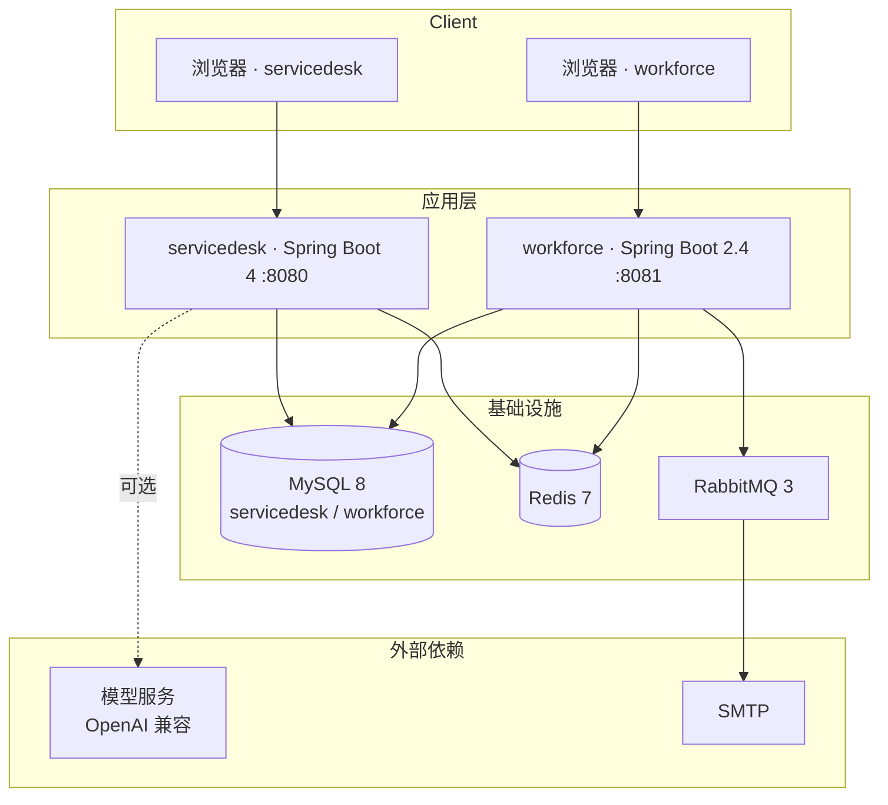
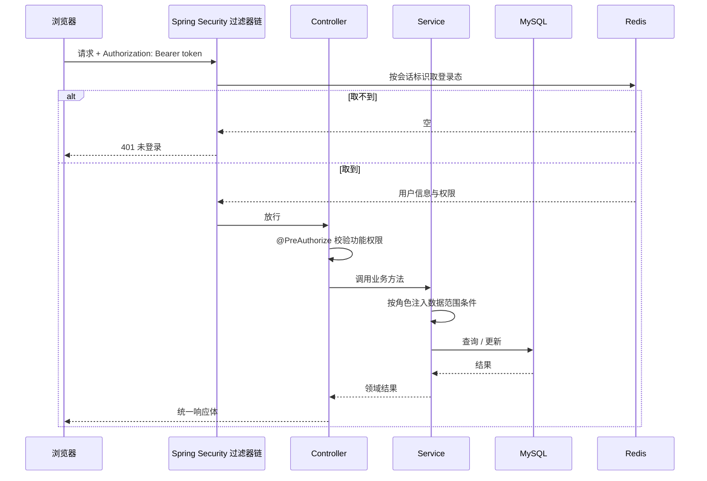
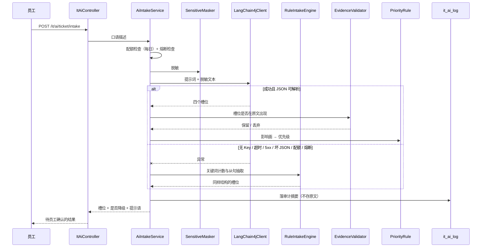
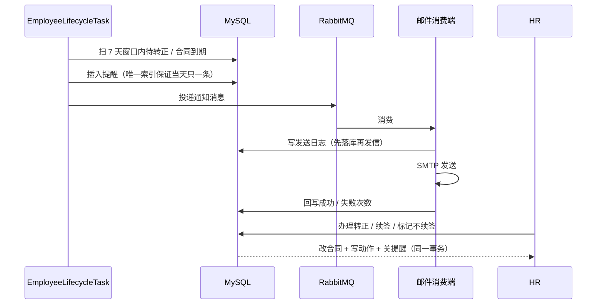

# 架构说明

两个系统各自独立，不共享库表、不互相调用；公共部分只有本地基础设施与工程约定。

## 1. 部署拓扑

- `workforce` 用 Flyway 管理表结构，启动时按版本执行；`servicedesk` 用手工脚本建库，Quartz 自带 `qrtz_*` 表。
- 模型服务是可选依赖：没有 Key 时 `servicedesk` 直接使用规则引擎，功能不缺失。

## 2. servicedesk 请求链路

权限是两层的，缺一不可：

| 层 | 决定什么 | 落地位置 |
|---|---|---|
| 功能权限 | 这个接口能不能调 | `@PreAuthorize("@ss.hasPermi('...')")` |
| 数据权限 | 调通之后能看到哪些行 | Service 查询前注入申请人 / 处理人条件 |
| 状态权限 | 这一行能不能改到这个状态 | 状态机校验，非法流转直接抛业务异常 |

## 3. servicedesk 的 AI 分诊链路

关键约束：AI 的输出**只包含信息字段**，不包含状态、处理人、优先级；
落库前服务端再截断长度、走枚举白名单，并强制把状态置为初始值。

## 4. workforce 的提醒链路

失败补偿：定时任务每 10 秒扫一次「待发送或失败且次数小于 3」的记录重新投递，
超过 3 次不再重试并保留记录，避免无限重试掩盖配置错误。

## 5. 模块职责

### servicedesk

| 模块 | 职责 |
|---|---|
| `desk-admin` | 启动类、HTTP 接口、登录与静态资源 |
| `desk-framework` | Security 过滤器链、JWT 会话与续期、数据权限切面、操作日志切面、全局异常 |
| `desk-system` | 工单 / 资产 / 处理记录 / AI 分诊的全部业务实现 |
| `desk-common` | 统一响应、分页工具、Excel、字符串与日期工具 |
| `desk-quartz` | 定时任务框架与超时提醒任务 |

### workforce

| 模块 | 职责 |
|---|---|
| `wf-web` | 启动类、Controller、登录过滤器与安全配置 |
| `wf-service` | 生命周期规则、续签规则、提醒与动作、定时扫描、邮件消费 |
| `wf-mapper` | Mapper 接口与 XML，待办查询与扫描 SQL 都在这里 |
| `wf-model` | 实体与常量 |

## 6. 环境变量

两个后端都支持环境变量覆盖配置，缺省值面向本地开发。

| 变量 | 作用 | 缺省 |
|---|---|---|
| `MYSQL_HOST` / `MYSQL_PORT` | 数据库地址 | `localhost` / `3306` |
| `MYSQL_USER` / `MYSQL_PASSWORD` | 数据库账号 | `root` / `root` |
| `MYSQL_DB_RY` | servicedesk 库名 | `servicedesk` |
| `MYSQL_DB_WORKFORCE` | workforce 库名 | `workforce` |
| `REDIS_HOST` / `REDIS_PORT` | Redis | `127.0.0.1` / `6379` |
| `RABBIT_HOST` / `RABBIT_PORT` | RabbitMQ | `127.0.0.1` / `5672` |
| `AI_BASE_URL` / `AI_API_KEY` / `AI_MODEL` | 模型服务 | 空（走规则引擎） |

## 7. 失败与降级矩阵

| 情况 | servicedesk | workforce |
|---|---|---|
| 数据库不可用 | 接口 500，统一异常体 | 同样 500；定时任务本次跳过 |
| Redis 不可用 | 登录态校验失败，返回未登录 | 提醒仍可落库，缓存退化为直查 |
| MQ 不可用 | 不影响工单主流程 | 发送日志留在库中，恢复后由补偿任务重投 |
| 模型不可用 | 降级规则引擎，返回 `degraded=true` | 不涉及 |
| 模型输出越界 | 证据校验丢弃 + 白名单置空 | 不涉及 |
